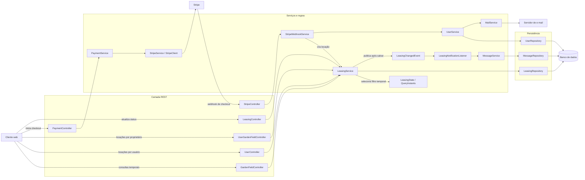

# Arquitetura geral e fluxo de uma locação

Representação do código atual na branch `refactor`. Situa o Strategy no fluxo de **consulta** e mostra, em paralelo, como uma locação é criada após o checkout. As setas indicam chamadas ou eventos observados no código; o diagrama não representa todos os endpoints do sistema.

Na consulta, `LeasingState` escolhe qual dos três parâmetros temporais é preenchido antes da chamada a `LeasingRepository`. Na criação, o cliente abre o checkout, a Stripe devolve o resultado por webhook, `StripeWebhookService` chama `LeasingService.createLeasing` e a locação é salva. O evento de mudança aciona a notificação de forma síncrona. O serviço de e-mail aparece como integração do fluxo de contas de usuário, não como parte da notificação de locação.
