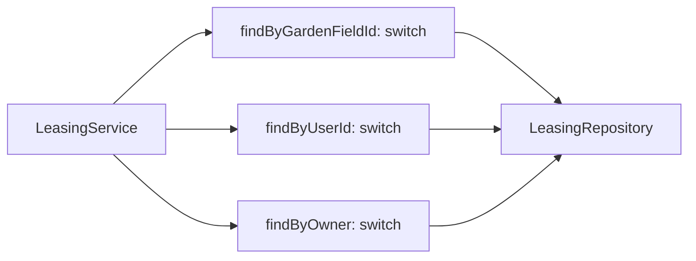
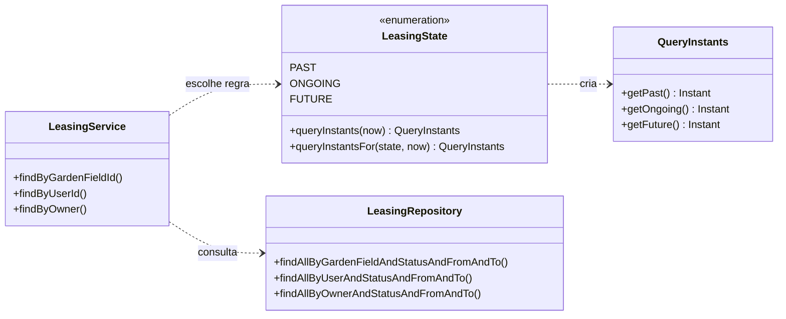

# 01 — Strategy: seleção do filtro temporal das locações

| Problema | Padrão | Refatoração | Benefício |
|---|---|---|---|
| Três consultas repetiam a mesma escolha entre `PAST`, `ONGOING` e `FUTURE` | Strategy por constante de enum | `LeasingState` passou a produzir a tripla de instantes usada pelo repositório | Três blocos `switch` no `LeasingService` passaram a zero |

## 1. Problema existente

O sistema permite consultar locações passadas, em andamento ou futuras. A escolha do filtro temporal aparecia três vezes em `LeasingService`: ao buscar por terreno, por usuário e por proprietário. Cada método precisava saber em qual dos três parâmetros do repositório colocar `Instant.now()`. Uma correção nessa regra teria de ser repetida nos três blocos, abrindo espaço para respostas diferentes entre consultas semelhantes.

## 2. Estrutura original

Na tag **`v1.0-original`**, `LeasingState.java:3-4` era apenas `PAST, ONGOING, FUTURE`. Já `LeasingService.java:179-245` continha um teste para `null` e um `switch` em cada um dos três métodos. Este é o trecho real da primeira consulta (`v1.0-original`, `src/main/java/com/gardle/service/LeasingService.java:183-199`):

```java
if (state == null) {
    return leasingRepository.findAllByGardenFieldAndStatusAndFromAndTo(pageable, gardenField, leasingStatusList, from, to,
        null, null, null).map(leasingMapper::toDto);
}
switch (state) {
    case PAST:
        return leasingRepository.findAllByGardenFieldAndStatusAndFromAndTo(pageable, gardenField, leasingStatusList,
            from, to, Instant.now(), null, null).map(leasingMapper::toDto);
    case ONGOING:
        return leasingRepository.findAllByGardenFieldAndStatusAndFromAndTo(pageable, gardenField, leasingStatusList,
            from, to, null, Instant.now(), null).map(leasingMapper::toDto);
    case FUTURE:
        return leasingRepository.findAllByGardenFieldAndStatusAndFromAndTo(pageable, gardenField, leasingStatusList,
            from, to, null, null, Instant.now()).map(leasingMapper::toDto);
    default:
        return leasingRepository.findAllByGardenFieldAndStatusAndFromAndTo(pageable, gardenField, leasingStatusList,
            from, to, null, null, null).map(leasingMapper::toDto);
}
```

As outras duas consultas tinham a mesma estrutura (`LeasingService.java:203-224` e `:226-245` na tag). Os três últimos argumentos representam, nessa ordem, `past`, `ongoing` e `future`; a consulta JPQL em `LeasingRepository.java` já aceitava esses parâmetros.



## 3. Padrão utilizado

**Strategy** — cada constante do enum conhece uma forma de preparar os parâmetros temporais. O conjunto de variantes é fechado e pequeno, por isso o comportamento por constante evita criar três classes quase vazias.

| Papel no Strategy | Classe ou elemento do projeto |
|---|---|
| Contexto | `LeasingService`, que executa as três consultas |
| Estratégia | Método abstrato `LeasingState.queryInstants(Instant)` |
| Estratégias concretas | Constantes `PAST`, `ONGOING` e `FUTURE`, cada uma com sua implementação |
| Seleção da estratégia | `LeasingState.queryInstantsFor(state, now)`, que também trata `null` |
| Resultado entregue ao contexto | `LeasingState.QueryInstants`, com `past`, `ongoing` e `future` |

## 4. Justificativa da escolha

Aqui o valor temporal **seleciona uma regra de preparação da consulta**. Ele não muda o status de uma locação; as transições `OPEN`, `RESERVED`, `REJECTED` e `CANCELLED` pertencem ao outro padrão, State. Uma função auxiliar com `switch` também removeria a triplicação, mas manteria as regras de cada variante em um bloco condicional. O enum com comportamento por constante põe cada regra ao lado do valor que a representa e deixa o instante como argumento, permitindo testes com hora fixa.

## 5. Alteração realizada

No commit `f30c1c5`, `LeasingState` recebeu `queryInstants(Instant)` e o resultado imutável `QueryInstants`. Os três métodos de `LeasingService` passaram a pedir essa tripla ao mesmo ponto. O commit `1221af9` registrou a validação dos testes da etapa. As assinaturas públicas dos métodos de consulta, suas anotações transacionais e o texto das exceções não foram alterados por Strategy; a consulta do repositório também permaneceu igual.

Trecho real atual de `LeasingService.java:153-160`:

```java
public Page<LeasingDTO> findByGardenFieldId(Pageable pageable, Long gardenFieldId, List<LeasingStatus> leasingStatusList, Instant from, Instant to, LeasingState state) {
    securityHelperService.checkPermissionByGardenFieldId(gardenFieldId);
    GardenField gardenField = gardenFieldRepository.findById(gardenFieldId)
        .orElseThrow(() -> new GardenFieldUnknownServiceException("Unknown Leasing"));
    LeasingState.QueryInstants instants = LeasingState.queryInstantsFor(state, Instant.now());
    return leasingRepository.findAllByGardenFieldAndStatusAndFromAndTo(pageable, gardenField, leasingStatusList,
        from, to, instants.getPast(), instants.getOngoing(), instants.getFuture()).map(leasingMapper::toDto);
}
```

## 6. Estrutura resultante

Trecho real de `LeasingState.java:5-46` para as três estratégias, o seletor e o resultado:

```java
public enum LeasingState {
    PAST {
        @Override
        public QueryInstants queryInstants(Instant now) {
            return new QueryInstants(now, null, null);
        }
    },
    ONGOING {
        @Override
        public QueryInstants queryInstants(Instant now) {
            return new QueryInstants(null, now, null);
        }
    },
    FUTURE {
        @Override
        public QueryInstants queryInstants(Instant now) {
            return new QueryInstants(null, null, now);
        }
    };

    public abstract QueryInstants queryInstants(Instant now);

    public static QueryInstants queryInstantsFor(LeasingState state, Instant now) {
        return state == null ? new QueryInstants(null, null, null) : state.queryInstants(now);
    }

    public static final class QueryInstants {
        private final Instant past;
        private final Instant ongoing;
        private final Instant future;

        private QueryInstants(Instant past, Instant ongoing, Instant future) {
            this.past = past;
            this.ongoing = ongoing;
            this.future = future;
        }

        public Instant getPast() { return past; }
        public Instant getOngoing() { return ongoing; }
        public Instant getFuture() { return future; }
    }
}
```



O fluxo completo de consulta e criação de locação aparece em `documentation-refactor/diagramas/arquitetura-geral.md`.

## 7. Benefícios obtidos

- **Reutilização:** os três métodos reutilizam a mesma seleção temporal. Havia **3 blocos `switch`** em `LeasingService` na tag original e há **0** agora.
- **Extensão:** para adicionar uma categoria que ainda caiba nos três parâmetros atuais, antes seria preciso editar **2 arquivos existentes** (`LeasingState` e os três blocos de `LeasingService`); agora, **1** (`LeasingState`). Se a categoria exigir outro parâmetro ou outra condição JPQL, o repositório também precisará mudar.
- **Manutenção:** o mapeamento de cada categoria para a posição da tripla está em uma única declaração, com **4 casos testados** (`PAST`, `ONGOING`, `FUTURE` e ausência de filtro).
- **Evolução:** as três assinaturas de serviço e de repositório não mudaram, permitindo que os controladores continuem chamando os mesmos métodos.

As métricas gerais do projeto, comparando a tag original ao `refactor` **já com quatro padrões aplicados**, estão em `docs/evidencias/metricas-antes.txt` e `metricas-depois.txt`: 179 → 187 arquivos Java, 162 → 170 declarações de classe, 9.265 → 9.442 linhas físicas, 4 → 1 ocorrências de `switch` e 6 → 6 de `else if`. Essas mudanças medem o trabalho acumulado e não são ganhos atribuídos apenas ao Strategy. O total de linhas e classes aumentou.

## Validação

| Item | Antes: `v1.0-original` | Depois: `refactor` (`867cde5`) |
|---|---:|---:|
| Testes Maven Surefire | 67 | 82 |
| Falhas / erros | 0 / 0 | 0 / 0 |
| Testes específicos de `LeasingState` | 0 | 4, todos aprovados |
| `switch` em `LeasingService` | 3 | 0 |

Comando igual nas duas versões, com **JDK 8** (`JAVA_HOME=/usr/lib/jvm/java-8-openjdk-amd64`):

```bash
./mvnw -o -Dmaven-surefire-plugin.version=3.5.6 -Dskip.npm -Dskip.installnodenpm test
```

Saídas completas, com valores sensíveis dos logs mascarados: `docs/evidencias/baseline-testes.txt` e `docs/evidencias/refatorado-testes.txt`. A diferença de **15 testes** corresponde ao conjunto acrescentado nas quatro refatorações, não apenas ao Strategy. O teste do Strategy usa um `Instant` fixo e verifica as três posições da tripla em cada caso. A revisão de `git diff v1.0-original..refactor -- src/test` não encontrou linhas removidas dos testes originais.

## Limitações

O enum concentra as variantes, mas continua exigindo edição quando uma categoria é adicionada; não oferece extensão por plugin em tempo de execução. A tripla de parâmetros também reflete a assinatura atual do repositório. O teste puro garante o posicionamento dos instantes, enquanto os testes de integração existentes validam o funcionamento geral das consultas; não há ainda um teste dedicado que compare as três consultas com registros passados, atuais e futuros no banco. Por fim, a contagem de `switch` mede duplicação visível, não desempenho ou qualidade global do sistema.
