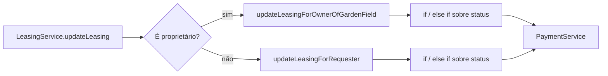
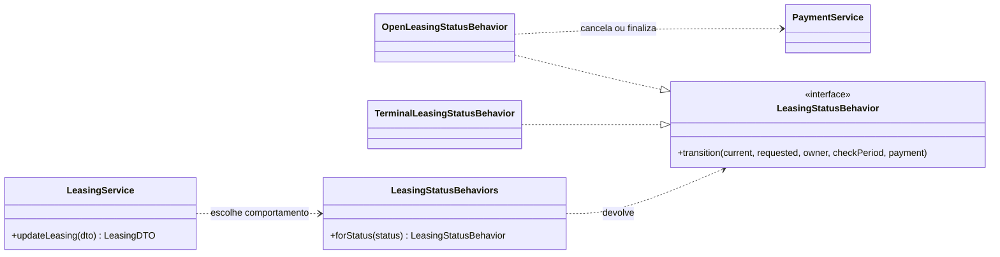

# 02 — State: transições do status de uma locação

| Problema | Padrão | Refatoração | Benefício |
|---|---|---|---|
| Regras de transição e efeitos de pagamento misturados em `LeasingService` | State | Comportamentos para `OPEN` e estados terminais, escolhidos pelo status atual | 7 comparações de status saíram do método de atualização do serviço |

## 1. Problema existente

Uma locação `OPEN` pode ser cancelada pelo solicitante, reservada pelo proprietário ou rejeitada pelo proprietário. Cada saída tem uma regra de papel e um efeito no pagamento. Antes, `LeasingService` decidia tudo isso em dois métodos privados. Era preciso ler os dois para entender quais transições eram permitidas e em que momento o pagamento seria cancelado ou finalizado.

## 2. Estrutura original

Na tag **`v1.0-original`**, `LeasingService.java:85-127` escolhia entre os métodos do proprietário e do solicitante. Este trecho real (`src/main/java/com/gardle/service/LeasingService.java:98-126`) mostra as regras completas de status:

```java
private void updateLeasingForRequester(Leasing currentLeasing, Leasing updatedLeasing) {
    checkIsUpdateAllowedInPeriod(currentLeasing);
    securityHelperService.checkPermission(currentLeasing.getUser().getId());
    // just status change is allowed from open to closed
    if (currentLeasing.getStatus().equals(LeasingStatus.OPEN) &&
        (updatedLeasing.getStatus().equals(LeasingStatus.CANCELLED))) {
        currentLeasing.setStatus(LeasingStatus.CANCELLED);
        paymentService.cancelPayment(currentLeasing.getPaymentSessionId());
    } else if (!currentLeasing.getStatus().equals(updatedLeasing.getStatus())) {
        throw new InvalidLeasingStateServiceException();
    }
}

private void updateLeasingForOwnerOfGardenField(Leasing currentLeasing, Leasing updatedLeasing) {
    // just status change is allowed from open to reserved or rejected
    if (currentLeasing.getStatus().equals(LeasingStatus.OPEN)) {
        if (updatedLeasing.getStatus().equals(LeasingStatus.RESERVED)) {
            checkIsUpdateAllowedInPeriod(currentLeasing);
            currentLeasing.setStatus(LeasingStatus.RESERVED);
            paymentService.finalizePayment(currentLeasing);
        } else if (updatedLeasing.getStatus().equals(LeasingStatus.REJECTED)) {
            currentLeasing.setStatus(LeasingStatus.REJECTED);
            paymentService.cancelPayment(currentLeasing.getPaymentSessionId());
        } else {
            throw new InvalidLeasingStateServiceException();
        }
    } else if (!currentLeasing.getStatus().equals(updatedLeasing.getStatus())) {
        throw new InvalidLeasingStateServiceException();
    }
}
```

A regra original também permitia repetir o mesmo status nos estados terminais. Para o solicitante, repetir `OPEN` era aceito após as checagens de prazo e permissão; para o proprietário, pedir `OPEN` novamente gerava exceção. Esses casos foram mantidos.



## 3. Padrão selecionado

**State**: o comportamento escolhido depende do status **atual** da locação. O nome `LeasingStatusBehavior` foi usado para não confundir o ciclo de vida com `LeasingState`, que representa o filtro temporal das consultas.

| Papel no State | Classe ou elemento do projeto |
|---|---|
| Contexto | `LeasingService.updateLeasing`, que consulta, autoriza, delega, salva e notifica |
| Interface de estado | `LeasingStatusBehavior.transition(...)` |
| Estado aberto | `OpenLeasingStatusBehavior` |
| Estados terminais | `TerminalLeasingStatusBehavior`, compartilhado por `RESERVED`, `REJECTED` e `CANCELLED` |
| Seleção pelo estado atual | `LeasingStatusBehaviors.forStatus(...)`, com um `EnumMap` |

## 4. Justificativa da escolha

As ações válidas mudam conforme a locação esteja aberta ou encerrada. Um simples *Extract Method* reduziria o tamanho do serviço, mas deixaria a seleção e as regras do ciclo de vida concentradas nele. O State permite que o comportamento aberto e o terminal tenham implementações próprias. Não foi criada uma classe para cada status terminal, pois os três fazem a mesma coisa: aceitam repetir o próprio status e rejeitam qualquer mudança.

## 5. Alteração realizada

O commit `60ad71d` introduziu a interface, os dois comportamentos e o seletor. `LeasingService` ainda determina o papel; para o solicitante, verifica prazo e permissão antes de delegar. Em `OPEN`, a reserva verifica prazo e finaliza o pagamento; a rejeição e o cancelamento cancelam o pagamento. O serviço continua salvando e emitindo o aviso após a transição. A etapa posterior de Observer mudou **a forma do aviso**, sem alterar as regras deste State.

As assinaturas públicas, o `@Transactional` de `LeasingService` e a mensagem de `InvalidLeasingStateServiceException` não mudaram. O efeito passa pelo mesmo `PaymentService`; o teste mocka seu `PaymentProviderService` para verificar a chamada externa.

## 6. Estrutura resultante

Trecho real atual de `LeasingService.java:88-100`:

```java
public LeasingDTO updateLeasing(UpdatingLeasingDTO leasingDTO) {
    Leasing updatedLeasing = updatingLeasingMapper.toEntity(leasingDTO);
    final Leasing currentLeasing = leasingRepository.findById(updatedLeasing.getId()).orElseThrow(LeasingNotFoundServiceException::new);
    boolean owner = securityHelperService.loggedInUserIsOwnerOfGardenField(currentLeasing.getGardenField().getId());
    if (!owner) {
        checkIsUpdateAllowedInPeriod(currentLeasing);
        securityHelperService.checkPermission(currentLeasing.getUser().getId());
    }
    LeasingStatusBehaviors.forStatus(currentLeasing.getStatus()).transition(currentLeasing, updatedLeasing.getStatus(),
        owner, () -> checkIsUpdateAllowedInPeriod(currentLeasing), paymentService);
    Leasing savedLeasing = leasingRepository.save(currentLeasing);
    eventPublisher.publishEvent(new LeasingChangedEvent(savedLeasing));
    return leasingMapper.toDto(savedLeasing);
}
```

Trecho real de `OpenLeasingStatusBehavior.java:12-28`:

```java
if (owner) {
    if (requested == LeasingStatus.RESERVED) {
        checkUpdatePeriod.run();
        current.setStatus(LeasingStatus.RESERVED);
        paymentService.finalizePayment(current);
    } else if (requested == LeasingStatus.REJECTED) {
        current.setStatus(LeasingStatus.REJECTED);
        paymentService.cancelPayment(current.getPaymentSessionId());
    } else {
        throw new InvalidLeasingStateServiceException();
    }
} else if (requested == LeasingStatus.CANCELLED) {
    current.setStatus(LeasingStatus.CANCELLED);
    paymentService.cancelPayment(current.getPaymentSessionId());
} else if (requested != LeasingStatus.OPEN) {
    throw new InvalidLeasingStateServiceException();
}
```



## 7. Benefícios obtidos

- **Reutilização:** `RESERVED`, `REJECTED` e `CANCELLED` compartilham **1 implementação** terminal, em vez de repetir sua regra em cada ramo.
- **Extensão:** para permitir uma nova saída de `OPEN` rumo a um **status já existente**, antes seria editado **1 arquivo existente** (`LeasingService`); agora, **1** (`OpenLeasingStatusBehavior`). O ganho é de localização da regra, não de quantidade de arquivos. Um status terminal novo também exigiria atualização do enum e do registro, custo descrito nas limitações.
- **Manutenção:** as **7 chamadas `getStatus().equals(...)`** dos dois métodos privados originais passaram a **0 dentro de `LeasingService.updateLeasing`**. A lógica de comparação foi movida para os comportamentos; não desapareceu do sistema.
- **Evolução:** o serviço público mantém o mesmo contrato e delega a transição antes de salvar. O comportamento de pagamento e as exceções foram verificados nos testes.

## Validação

| Item | Antes: `v1.0-original` | Depois: `refactor` (`867cde5`) |
|---|---:|---:|
| Suíte completa Maven Surefire | 67 testes | 82 testes |
| Falhas / erros | 0 / 0 | 0 / 0 |
| `LeasingServiceTest` | 15 testes | 16 testes; o teste adicional pertence à etapa Observer |
| `LeasingStatusBehaviorTest` | inexistente | 8 testes, todos aprovados |
| Comparações de status dentro de `LeasingService.updateLeasing` e auxiliares originais | 7 | 0 |

Comando da suíte, igual nas duas versões, com JDK 8 (`JAVA_HOME=/usr/lib/jvm/java-8-openjdk-amd64`):

```bash
./mvnw -o -Dmaven-surefire-plugin.version=3.5.6 -Dskip.npm -Dskip.installnodenpm test
```

Saídas completas com valores sensíveis mascarados: `docs/evidencias/baseline-testes.txt` e `docs/evidencias/refatorado-testes.txt`. A suíte refatorada soma testes dos quatro padrões; não se atribui a diferença total ao State. A revisão de `git diff v1.0-original..refactor -- src/test` não encontrou remoção de testes originais.

## Limitações

O seletor usa um registro `EnumMap` fechado. Um status novo exige incluí-lo em `LeasingStatus` e cadastrá-lo em `LeasingStatusBehaviors`; se tiver regra própria, precisa de outra implementação. O comportamento recebe `boolean owner`, `Runnable` e `PaymentService`, o que mantém a assinatura simples mas mistura dados de autorização, prazo e pagamento na operação. As comparações de status saíram do serviço e permanecem no estado aberto. A refatoração não torna novas transições livres de edição nem substitui testes de integração do fluxo financeiro real.
