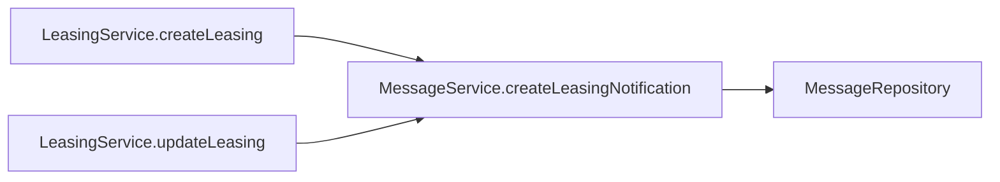
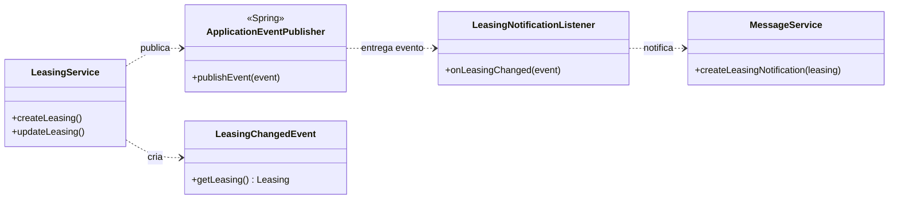

# 03 — Observer: notificação após mudança de locação

| Problema | Padrão | Refatoração | Benefício |
|---|---|---|---|
| `LeasingService` chamava `MessageService` diretamente após criar e atualizar locações | Observer com eventos do Spring | Publicação de `LeasingChangedEvent` e listener síncrono de notificação | Dependência direta do serviço de locações em `MessageService`: 1 → 0 |

## 1. Problema existente

Criar ou atualizar uma locação terminava com o envio de uma mensagem. O `LeasingService` precisava conhecer `MessageService` e chamar o mesmo método em dois fluxos. Se outra reação surgisse, como registrar auditoria da alteração, o serviço de locações precisaria ser editado novamente. A notificação era parte síncrona da operação: uma falha chegava ao chamador.

## 2. Estrutura original

Na tag **`v1.0-original`**, `LeasingService.java:53` declarava `private final MessageService messageService;`. Os trechos reais de `src/main/java/com/gardle/service/LeasingService.java:79-82` e `:93-95` mostram os dois pontos:

```java
leasing.setStatus(LeasingStatus.OPEN);
leasing = leasingRepository.save(leasing);
messageService.createLeasingNotification(leasing);
return leasingMapper.toDto(leasing);
```

```java
currentLeasing = leasingRepository.save(currentLeasing);
messageService.createLeasingNotification(currentLeasing);
return leasingMapper.toDto(currentLeasing);
```



## 3. Padrão selecionado

**Observer**, realizado com `ApplicationEventPublisher` e `@EventListener` do Spring. O evento carrega a locação salva, e um ouvinte executa a reação de notificação.

| Papel no Observer | Classe ou elemento do projeto |
|---|---|
| Sujeito/publicador | `LeasingService`, por meio de `ApplicationEventPublisher` |
| Evento | `LeasingChangedEvent` |
| Infraestrutura de inscrição e despacho | Mecanismo de eventos do Spring |
| Observador concreto | `LeasingNotificationListener.onLeasingChanged` |
| Ação observadora | `MessageService.createLeasingNotification` |

## 4. Justificativa da escolha

A mensagem é uma reação à criação ou alteração de uma locação, não uma condição para decidir o novo status. O Observer permite acrescentar outra reação criando outro listener, sem editar os dois métodos que publicam o evento. Uma chamada direta com *Extract Method* deixaria a dependência no mesmo serviço. `@Async` ou `@TransactionalEventListener` mudariam o momento de execução e a propagação de falhas; foram evitados para preservar o comportamento original.

## 5. Alteração realizada

O commit `4cb59f3` substituiu as duas chamadas diretas por `publishEvent(new LeasingChangedEvent(...))`, removeu a dependência de `MessageService` do `LeasingService` e criou `LeasingNotificationListener`. A anotação `@EventListener` é usada sem `@Async` e sem `@TransactionalEventListener`. A publicação ocorre depois do `save` e antes da conversão para DTO, dentro do método `@Transactional` do serviço. A alteração veio depois do State; por isso o método `updateLeasing` já aparece com a delegação de transição na versão atual.

As assinaturas públicas, o `@Transactional` de `LeasingService` e as mensagens de exceção não foram alterados por Observer. O teste de falha da notificação confirma que a exceção ainda volta pela chamada original.

## 6. Estrutura resultante

Trechos reais atuais de `LeasingService.java:82-85`, `:98-100` e `LeasingNotificationListener.java:8-16`:

```java
leasing = leasingRepository.save(leasing);
eventPublisher.publishEvent(new LeasingChangedEvent(leasing));
return leasingMapper.toDto(leasing);
```

```java
Leasing savedLeasing = leasingRepository.save(currentLeasing);
eventPublisher.publishEvent(new LeasingChangedEvent(savedLeasing));
return leasingMapper.toDto(savedLeasing);
```

```java
@Component
@RequiredArgsConstructor
public class LeasingNotificationListener {
    private final MessageService messageService;

    @EventListener
    public void onLeasingChanged(LeasingChangedEvent event) {
        messageService.createLeasingNotification(event.getLeasing());
    }
}
```



## 7. Benefícios obtidos

- **Reutilização:** o mesmo tipo `LeasingChangedEvent` é publicado nos **2 fluxos** e pode ser observado por outros componentes.
- **Extensão:** para uma nova reação ao evento já publicado, antes seria necessário editar **1 arquivo existente** (`LeasingService`, em dois pontos) além de criar a nova classe; agora são **0 arquivos existentes** e um novo listener. Essa comparação assume uma reação independente que possa usar o evento atual.
- **Manutenção:** o campo direto de `MessageService` no `LeasingService` passou de **1 para 0**; as **2 chamadas diretas** também passaram a zero. A dependência de mensagens ficou no listener, enquanto o serviço passou a depender do publicador de eventos.
- **Evolução:** a notificação continua síncrona e antes do retorno. O teste confirma transação ativa durante a chamada e propagação da exceção quando o aviso falha.

## Validação

| Item | Antes: `v1.0-original` | Depois: `refactor` (`867cde5`) |
|---|---:|---:|
| Suíte completa Maven Surefire | 67 testes | 82 testes |
| Falhas / erros | 0 / 0 | 0 / 0 |
| `LeasingServiceTest` | 15 testes | 16 testes |
| Chamadas diretas a `createLeasingNotification` em `LeasingService` | 2 | 0 |
| Listener da locação | inexistente | 1, com `@EventListener` síncrono |

Comando igual nas duas versões, usando JDK 8 (`JAVA_HOME=/usr/lib/jvm/java-8-openjdk-amd64`):

```bash
./mvnw -o -Dmaven-surefire-plugin.version=3.5.6 -Dskip.npm -Dskip.installnodenpm test
```

Saídas completas com valores sensíveis mascarados: `docs/evidencias/baseline-testes.txt` e `docs/evidencias/refatorado-testes.txt`. `LeasingServiceTest` verifica a notificação após criação e atualização; `testNotificationFailurePropagatesDuringCreation` verifica o erro síncrono. O total de 82 inclui os outros padrões. A revisão de `git diff v1.0-original..refactor -- src/test` não encontrou remoção de testes originais.

## Limitações

O desacoplamento é do serviço de locações em relação ao serviço de mensagens, não do sistema inteiro em relação às notificações. Eventos síncronos mantêm a latência e o risco de falha da notificação no fluxo principal, exatamente como antes. A ordem entre futuros listeners pode exigir uma política explícita se um depender do outro. O teste verifica a transação ativa na chamada e a propagação da falha, mas não simula indisponibilidade real do armazenamento de mensagens.
