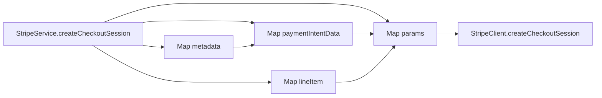
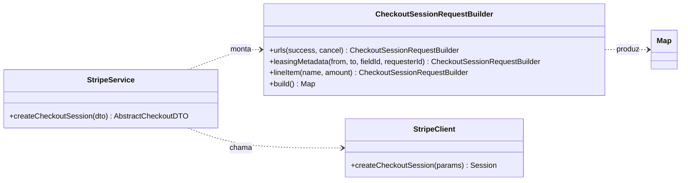

# 04 — Builder: montagem do checkout da Stripe

| Problema | Padrão | Refatoração | Benefício |
|---|---|---|---|
| `StripeService` montava uma requisição aninhada com mapas e chaves literais | Builder | `CheckoutSessionRequestBuilder` recebe dados tipados e produz o mapa esperado pelo cliente | Chamadas `put` no método de checkout de `StripeService`: 15 → 0 |

## 1. Problema existente

Para abrir uma sessão de checkout, `StripeService` montava manualmente metadados da locação, intenção de pagamento, item cobrado, forma de pagamento e URLs de retorno. O método de integração misturava a obtenção dos dados com o formato exato exigido pelo cliente Stripe. Para conferir um campo, era necessário acompanhar vários `Map` aninhados e suas chaves de texto.

## 2. Estrutura original

Na tag **`v1.0-original`**, o método `createCheckoutSessionRequestParamsFromCreatorLeasingDTO` de `StripeService.java:144-173` continha **15 chamadas `put`**. Trecho real de `src/main/java/com/gardle/service/StripeService.java:144-170`:

```java
private Map<String, Object> createCheckoutSessionRequestParamsFromCreatorLeasingDTO(final CreatorLeasingDTO creatorLeasingDTO) {
    Map<String, Object> paymentIntentData = new HashMap<>();
    paymentIntentData.put("capture_method", "manual");

    Map<String, String> paymentIntentMetaData = new HashMap<>();
    paymentIntentMetaData.put("leasing_from", creatorLeasingDTO.getFrom().toString());
    paymentIntentMetaData.put("leasing_to", creatorLeasingDTO.getTo().toString());
    paymentIntentMetaData.put("leasing_gardenfield_id", creatorLeasingDTO.getGardenFieldId().toString());
    paymentIntentMetaData.put("leasing_requester_id", securityHelperService.getLoggedInUser().getId().toString());

    paymentIntentData.put("metadata", paymentIntentMetaData);

    List<Object> paymentMethodTypes = new ArrayList<>();
    paymentMethodTypes.add("card");
    List<Object> lineItems = new ArrayList<>();
    Map<String, Object> lineItem1 = new HashMap<>();
    lineItem1.put("name", creatorLeasingDTO.getGardenFieldName());
    lineItem1.put("amount", creatorLeasingMapper.toEntity(creatorLeasingDTO).getPriceSumInCents());
    lineItem1.put("currency", "eur");
    lineItem1.put("quantity", 1);
    lineItems.add(lineItem1);
    Map<String, Object> params = new HashMap<>();
    params.put("success_url", paymentSuccessUrl);
    params.put("cancel_url", paymentCancelUrl);
    params.put("payment_method_types", paymentMethodTypes);
    params.put("line_items", lineItems);
    params.put("payment_intent_data", paymentIntentData);
```

As três linhas seguintes na tag devolviam `params` e fechavam o método. `StripeClient.createCheckoutSession(Map<String, Object>)` recebia esse mapa sem alteração.



## 3. Padrão selecionado

**Builder** para a requisição de checkout. A interface `StripeClient` continua recebendo o produto final como `Map<String, Object>`; o padrão organiza **como esse produto é construído**, sem mudar a API externa.

| Papel no Builder | Classe ou elemento do projeto |
|---|---|
| Cliente que conduz as etapas | `StripeService` |
| Builder concreto | `CheckoutSessionRequestBuilder` |
| Etapas de montagem | `urls`, `leasingMetadata`, `lineItem` |
| Operação de finalização | `build()` |
| Produto entregue | `Map<String, Object>` da sessão de checkout |
| Consumidor do produto | `StripeClient.createCheckoutSession` |

## 4. Justificativa da escolha

O checkout tem grupos de campos relacionados e estrutura aninhada. O Builder permite reunir dados tipados em etapas nomeadas e validar a presença dos campos necessários antes de entregar o mapa ao cliente. Um método auxiliar estático também retiraria os `put` de `StripeService`, mas não deixaria tão visíveis as etapas nem a checagem em `build()`. Uma hierarquia de builders seria exagero: há uma única variante de checkout; por isso foi criada apenas uma classe concreta. A criação de conta Stripe ficou fora do escopo porque seu payload é diferente.

## 5. Alteração realizada

O commit `867cde5` introduziu `CheckoutSessionRequestBuilder` e trocou o corpo do método privado de `StripeService` por chamadas a `urls`, `leasingMetadata`, `lineItem` e `build`. A obtenção do usuário, o cálculo do preço e a chamada a `StripeClient` continuam no serviço. Os nomes das chaves, as URLs, a moeda `eur`, o método `card`, a captura `manual`, a quantidade `1` e os quatro metadados permaneceram iguais. `StripeService.createCheckoutSession` continua lançando `IllegalArgumentException("payment dto null")` para entrada nula; as assinaturas públicas, anotações transacionais e mensagens de exceção existentes não foram mudadas.

## 6. Estrutura resultante

Trecho real atual de `StripeService.java:145-153`:

```java
private Map<String, Object> createCheckoutSessionRequestParamsFromCreatorLeasingDTO(final CreatorLeasingDTO creatorLeasingDTO) {
    return new CheckoutSessionRequestBuilder()
        .urls(paymentSuccessUrl, paymentCancelUrl)
        .leasingMetadata(creatorLeasingDTO.getFrom(), creatorLeasingDTO.getTo(),
            creatorLeasingDTO.getGardenFieldId(), securityHelperService.getLoggedInUser().getId())
        .lineItem(creatorLeasingDTO.getGardenFieldName(),
            creatorLeasingMapper.toEntity(creatorLeasingDTO).getPriceSumInCents())
        .build();
}
```

Trechos reais de `CheckoutSessionRequestBuilder.java:41-49` e `:72-79` mostram a validação e a entrega:

```java
public Map<String, Object> build() {
    Objects.requireNonNull(successUrl, "successUrl");
    Objects.requireNonNull(cancelUrl, "cancelUrl");
    Objects.requireNonNull(leasingFrom, "leasingFrom");
    Objects.requireNonNull(leasingTo, "leasingTo");
    Objects.requireNonNull(gardenFieldId, "gardenFieldId");
    Objects.requireNonNull(requesterId, "requesterId");
    Objects.requireNonNull(itemName, "itemName");
    Objects.requireNonNull(amountInCents, "amountInCents");
```

```java
Map<String, Object> request = new HashMap<>();
request.put("success_url", successUrl);
request.put("cancel_url", cancelUrl);
request.put("payment_method_types", paymentMethodTypes);
request.put("line_items", lineItems);
request.put("payment_intent_data", paymentIntentData);
return request;
```

Os dois blocos pertencem ao mesmo método `build`; entre eles, a classe monta os mapas internos. Eles foram separados aqui para mostrar as duas responsabilidades sem repetir o arquivo inteiro.



## 7. Benefícios obtidos

- **Reutilização:** a montagem do payload ficou em **1 classe própria**, que pode ser usada por outro fluxo de checkout se os mesmos campos forem necessários.
- **Extensão:** adicionar um campo ao payload existente exigia editar **1 arquivo** (`StripeService`); agora exige editar **1** (`CheckoutSessionRequestBuilder`). A vantagem é concentrar as chaves da requisição, não reduzir a contagem de arquivos. Um campo que venha de outra fonte pode exigir também alteração no serviço.
- **Manutenção:** as **15 chamadas `put`** do método de checkout em `StripeService` passaram a **0**. Elas foram movidas para o builder; o formato do mapa não foi simplificado nem eliminado.
- **Evolução:** a assinatura de `StripeClient.createCheckoutSession` continua a mesma, e o teste de caracterização comprova o payload recebido antes e depois para uma locação fixa.

## Validação

| Item | Antes: `v1.0-original` | Depois: `refactor` (`867cde5`) |
|---|---:|---:|
| Suíte completa Maven Surefire | 67 testes | 82 testes |
| Falhas / erros | 0 / 0 | 0 / 0 |
| `StripeServiceTest` | 7 testes | 8 testes, incluindo captura do mapa |
| `CheckoutSessionRequestBuilderTest` | inexistente | 1 teste de campo obrigatório |
| Chamadas `put` no método privado de checkout de `StripeService` | 15 | 0 |

Comando igual nas duas versões, com JDK 8 (`JAVA_HOME=/usr/lib/jvm/java-8-openjdk-amd64`):

```bash
./mvnw -o -Dmaven-surefire-plugin.version=3.5.6 -Dskip.npm -Dskip.installnodenpm test
```

Saídas completas com valores sensíveis mascarados: `docs/evidencias/baseline-testes.txt` e `docs/evidencias/refatorado-testes.txt`. Antes de mover o código, o teste de caracterização do mapa foi executado no código antigo e passou; depois, passou novamente com o builder. Esse passo intermediário está descrito no histórico da etapa, enquanto a comparação da tabela usa a tag original e o estado final. A revisão de `git diff v1.0-original..refactor -- src/test` não encontrou remoção de testes originais.

## Limitações

`build()` valida a presença de valores, mas não confirma semanticamente URL, período, valor positivo ou regras da Stripe. O produto ainda é um `Map<String, Object>` mutável, pois esse é o contrato atual de `StripeClient`. O builder não reduz a quantidade total de chaves literais: ele as isola. Há uma única forma de checkout no projeto; se ela permanecer simples e estável, a classe adicional pode custar mais manutenção do que economiza. A verificação usa cliente mockado, sem chamada de rede à Stripe.
